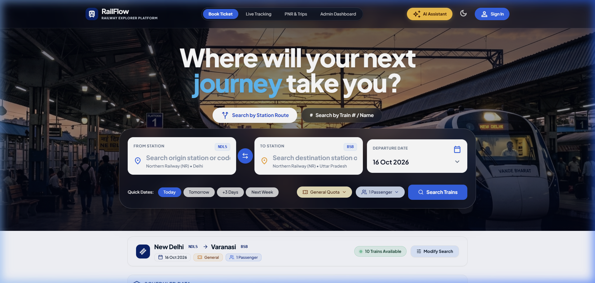
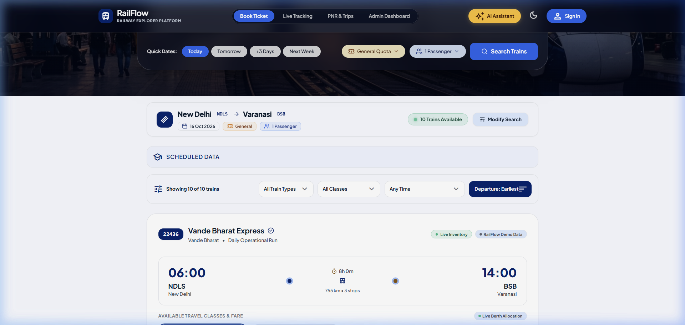
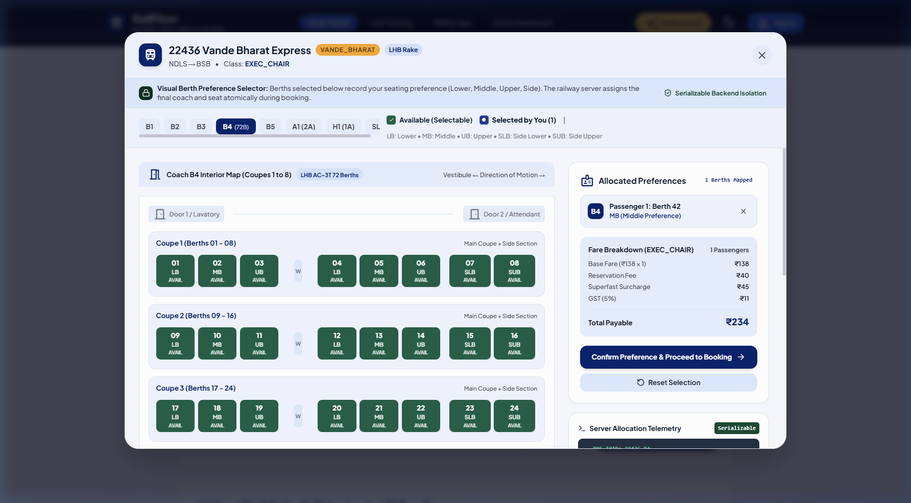
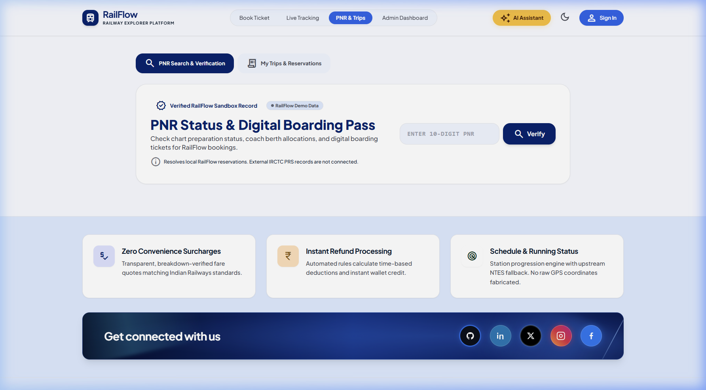
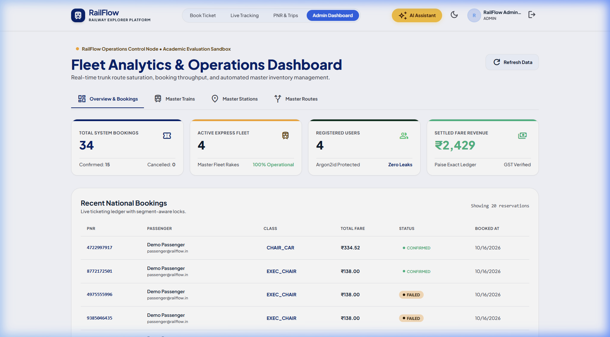

# RailFlow — Modern Railway Reservation & Operations Platform

> **Academic Portfolio Project & Technical Showcase**  
> RailFlow is an end-to-end railway reservation and operational management web application designed with enterprise-grade TypeScript, Express, React 19, and Prisma.  
> *Disclaimer: RailFlow is an educational simulation. It is NOT affiliated with Indian Railways, IRCTC, or CRIS, and passes issued are not valid for actual transit.*

---

## 1. Project Overview & Features

RailFlow models the complete lifecycle of passenger railway operations, from timetable scheduling and dynamic berth allocation to payment simulation, PNR generation, cancellation refunds, and administrator master-data management.

### Key Capabilities
- **Real-Time Train Search & Corridor Routing:** Search multi-stop schedules with origin, destination, travel dates, quotas (General, Tatkal, Ladies, Senior Citizen), and passenger counts.
- **Dynamic Inventory Generation:** Segment-aware berth allocation across express classes (1A, 2A, 3A, SL, CC, EC) generating coaches and seats on-demand without duplication or race conditions.
- **Advanced Search Results Filtering & Sorting:** Sort trains by departure time, trip duration, or lowest fare; filter by train type (Vande Bharat, Rajdhani, Shatabdi), travel class, and departure time of day.
- **Atomic Booking Lifecycle & Simulated Payment:** Two-phase booking reservation with concurrency safeguards, idempotency checks, and automated seat allocation.
- **Persisted PNR Console & Print-Friendly Tickets:** Inspect journey status, coach and seat assignments, and print clean e-reservation slips with clear academic simulation disclaimers.
- **Tiered Cancellation & Refund Engine:** Instant ticket cancellation calculating standard departure-tier deductions and recording transparent refund logs.
- **Live Train Tracking with ChukChuk & Timetable Fallback:** GPS-based running status using the ChukChuk microservice with automatic failover to timetable schedule projection and in-memory caching.
- **Complete Admin Master CRUD Console:** Dedicated administrator interface with strict Zod validation, relationship protection, and destructive confirmation modals to manage Trains, Stations, and Routes.
- **Interactive OpenAPI / Swagger 3.0 Documentation:** Interactive API documentation hosted natively at `/api/docs` and machine-readable spec at `/api/docs.json`.
- **Persistent Database Session Store:** Production-ready SQLite session persistence preventing user logout across server restarts.
- **RailFlow AI Journey Assistant (Google Gemini Free Tier):** Controlled AI assistant with server-side tool-calling for real train schedule lookup, authoritative GST fare breakdowns, PNR ownership isolation, and live tracking without LLM hallucinations.

---

## 📸 Screenshots

### 1. Homepage & Intelligent Train Search
Modern hero interface featuring rapid station-to-station route search, departure date selectors, travel quotas, and responsive navigation.



### 2. Train Search Results & Timetable Matrix
Timetable results displaying scheduled departure/arrival times, travel durations, stops, and available travel classes.



### 3. Visual Seat Availability & Coach Matrix
Interactive coach interior map enabling visual berth selection across coupes (Lower, Middle, Upper, Side Berths) with dynamic fare computation.



### 4. PNR Status & Digital Boarding Pass
Reservation lookup console displaying passenger manifests, booking confirmation states, and digital boarding passes.



### 5. Fleet Analytics & Operations Dashboard
Administrative management console for monitoring national bookings, active express fleet rakes, user registrations, and system throughput.



---

## 2. Architecture & Data Flow

```
                      +-----------------------------+
                      |   Passenger / Admin Browser  |
                      |  (React 19 + Vite + Tailwind)|
                      +--------------+--------------+
                                     |
                         HTTP / REST API (CORS)
                                     |
                                     v
                      +-----------------------------+
                      |     Express Backend API     |
                      |   • Helmet CSP & Security   |
                      |   • Zod Schema Validation   |
                      |   • Argon2 Password Hashing |
                      |   • Persistent Sessions     |
                      |   • OpenAPI / Swagger Docs  |
                      |   • Controlled AI Registry  |
                      +-------+------+-------+------+
                              |      |       |
           Prisma ORM Queries |      |       | Google Gemini API v1beta
                              v      |       v (Free-tier gemini-2.0-flash)
     +--------------------------+    |   +-----------------------+
     |   SQLite Database        |    |   | Google AI Studio      |
     |   (prisma/dev.db)        |    |   | (Tool-Calling Engine) |
     |   • Stations & Trains    |    |   +-----------------------+
     |   • Inventory & Bookings |    |
     |   • Sessions & Audits    |    v HTTP Proxy / Failover
     +--------------------------+  +-----------------------+
                                   | ChukChuk Microservice |
                                   | (Python / FastAPI)    |
                                   +-----------------------+
```

---

## 3. Technology Stack

| Layer | Technologies |
|---|---|
| **Frontend** | React 19, TypeScript 5, Vite 8, TailwindCSS 3.4, React Router 6, TanStack Query 5, Oxlint |
| **Backend** | Node.js 20+, Express 4.21, TypeScript 5.6, Prisma ORM 5.22, Zod 3.23, Argon2, Swagger UI Express |
| **Database** | SQLite (development/local via `prisma/dev.db`), PostgreSQL compatible schema |
| **Testing** | Vitest 2.1, Supertest 7.0 (41 integration & concurrency tests) |
| **Tracking** | Python 3.10+ FastAPI (optional ChukChuk microservice) |

---

## 4. Windows Prerequisites & Installation

### Prerequisites
- **Node.js**: `v20.x` LTS or later ([Download Node.js](https://nodejs.org/))
- **npm**: `v10.x` or later (bundled with Node.js)
- **PowerShell**: Windows PowerShell 5.1+ or PowerShell 7+
- **Git for Windows**: Recommended for cloning and version control
- **Python 3.10+**: *(Optional)* Required only if running the external ChukChuk scraper

### Installation Steps

1. **Clone or Navigate to the Workspace:**
   ```powershell
   cd "c:\Users\santanu dey\Downloads\railflow\railflow-app"
   ```

2. **Install Backend Dependencies:**
   ```powershell
   cd server
   npm install
   ```

3. **Install Frontend Dependencies:**
   ```powershell
   cd ..\client
   npm install
   ```

---

## 5. Environment Configuration

### Backend Configuration (`railflow-app/server/.env`)
Create a `.env` file in `railflow-app/server` with the following variables:

```env
# Server Networking
PORT=5000
NODE_ENV=development

# Database Connection (SQLite)
DATABASE_URL="file:./dev.db"

# Session Security (Use a secure, random 32+ character string in production)
SESSION_SECRET=railflow-development-session-secret-change-in-production

# CORS Allowed Origin
CORS_ORIGIN=http://localhost:5173

# Optional Real Train Tracking Microservice
CHUKCHUK_API_URL=http://127.0.0.1:8000

# Google Gemini AI Journey Assistant (Google AI Studio Free Tier)
# Get a free key at: https://aistudio.google.com/
GEMINI_API_KEY="your_gemini_api_key_here"
GEMINI_MODEL="gemini-2.0-flash"
```

> **AI Assistant Free-Tier Note:** The assistant defaults to `gemini-2.0-flash` on Google AI Studio's free tier. If the key is not set or the free-tier quota is reached, RailFlow gracefully degrades with an informative notice while all standard search, booking, payment, and tracking forms continue to function normally.

> **Security Rule:** Never commit real secrets, private keys, or credentials to version control. Replace default development strings with secure random values in production environments.

### Frontend Configuration (`railflow-app/client/.env`)
Create a `.env` file in `railflow-app/client` if customizing the backend URL:

```env
VITE_API_URL=http://localhost:5000/api
```

---

## 6. Database Migration & Seeding

All database actions are managed through Prisma ORM.

1. **Generate Prisma Client:**
   ```powershell
   cd railflow-app\server
   npm run db:generate
   ```

2. **Apply Migrations Safely:**
   ```powershell
   npm run db:migrate
   ```

3. **Seed Master Data (Stations, Trains, Schedules, Admin Account):**
   ```powershell
   npm run db:seed
   ```
   *Seeded Credentials for Local Testing:*
   - **Administrator:** `admin@railflow.in` / `Admin@123`
   - **Passenger:** `passenger@railflow.in` / `User@123`

4. **Destructive Reset (Wipes all database records and re-runs seed):**
   ```powershell
   npm run db:reset
   ```

---

## 7. Running the Application

### 1. Start the Backend API Server
```powershell
cd railflow-app\server
npm run dev
```
- API will start on: `http://localhost:5000`
- Interactive OpenAPI Docs: `http://localhost:5000/api/docs`
- Health Check Endpoint: `http://localhost:5000/api/health`

### 2. Start the Frontend Application
In a separate terminal:
```powershell
cd railflow-app\client
npm run dev
```
- Web interface will start on: `http://localhost:5173`

### 3. (Optional) Run the ChukChuk Train-Tracking Service
In a separate terminal with Python 3.10+:
```powershell
cd railflow-app\chukchuk-api
python -m venv .venv
.\.venv\Scripts\activate
pip install -r requirements.txt
uvicorn main:app --host 127.0.0.1 --port 8000
```
*Note: If ChukChuk is not running, RailFlow seamlessly falls back to timetable simulation.*

---

## 8. Test, Typecheck, Lint & Build Commands

All commands have been verified against active project configuration:

### Backend Commands (`railflow-app/server`)
| Command | Action | Verification |
|---|---|---|
| `npm test` | Runs 55 Vitest integration, concurrency & AI tool tests | Verified passing (55/55 across 3 suites) |
| `npm run typecheck` | Runs `tsc --noEmit` strict type check | Verified 0 errors |
| `npm run build` | Compiles TypeScript to `dist/` | Verified 0 errors |

### Frontend Commands (`railflow-app/client`)
| Command | Action | Verification |
|---|---|---|
| `npm run lint` | Runs `oxlint` static code analysis | Verified 0 errors |
| `npm run typecheck` | Runs `tsc -b` project type validation | Verified 0 errors |
| `npm run build` | Compiles assets with Vite production bundler | Verified 0 errors |

---

## 9. API Documentation & OpenAPI Specification

Interactive Swagger UI is mounted at `/api/docs`.

### Key Documented Endpoints
- **Authentication**: `POST /api/auth/register`, `POST /api/auth/login`, `GET /api/auth/me`, `POST /api/auth/logout`
- **Stations & Trains**: `GET /api/stations`, `GET /api/trains/search`
- **Fares & Quotes**: `GET /api/fares/quote`
- **Bookings & PNR**: `POST /api/bookings`, `GET /api/bookings/my`, `GET /api/bookings/pnr/:pnr`
- **Payment Simulation**: `POST /api/payments/simulate`
- **Cancellations & Refunds**: `POST /api/bookings/:id/cancel`
- **Tracking**: `GET /api/tracking/:number`
- **Admin Master CRUD**:
  - Trains: `GET /api/admin/trains`, `POST /api/admin/trains`, `PUT /api/admin/trains/:id`, `DELETE /api/admin/trains/:id`
  - Stations: `GET /api/admin/stations`, `POST /api/admin/stations`, `PUT /api/admin/stations/:id`, `DELETE /api/admin/stations/:id`
  - Routes: `GET /api/admin/routes`, `POST /api/admin/routes`, `PUT /api/admin/routes/:id`

---

## 10. Demo-Mode Limitations & External Integrations

1. **Non-Commercial Academic Simulation**: RailFlow is designed for software engineering demonstrations, university capstone submissions, and architectural interviews. It does not interface with the live IRCTC or CRIS production mainframes.
2. **Persistent Session Storage**: Uses a local SQLite table (`sessionStore.ts`) for zero-configuration persistence across server restarts. For multi-instance, clustered production deployments, swap to `connect-redis` or PostgreSQL session store.
3. **Payment Simulation**: Includes an immediate sandbox gateway simulation. Integrating real banking transactions requires registering a Razorpay or Stripe merchant account and configuring webhook verification secrets.
4. **Capacity Controls**: Bookings that exceed available berths return `409 INSUFFICIENT_SEATS`. RAC (Reservation Against Cancellation) and Waitlist (WL) auto-confirmation algorithms are reserved for subsequent milestones.

---

## 11. Troubleshooting Guide

| Issue | Cause | Solution |
|---|---|---|
| `Error: P2021 Table does not exist` | Prisma schema migrated but client not generated | Run `npm run db:generate` followed by `npm run db:push` in `server`. |
| `401 UNAUTHENTICATED` on API calls | Session cookie missing or expired | Ensure credentials/cookies are included in requests (`withCredentials: true`). Sign in via `/api/auth/login`. |
| `EADDRINUSE: address already in use :::5000` | Another process is holding port 5000 | Find and terminate the process using `Get-Process -Id (Get-NetTCPConnection -LocalPort 5000).OwningProcess | Stop-Process -Force` in PowerShell. |
| `ChukChuk provider failed: fetch failed` | Optional ChukChuk microservice is offline | Expected behavior. RailFlow will log a warning and automatically activate its timetable-based fallback provider. |
| `CORS Error in Browser Console` | Client origin does not match `CORS_ORIGIN` in `.env` | Verify `CORS_ORIGIN=http://localhost:5173` in `server/.env`. |

---

## 12. Production Deployment Guidance

1. **Database Migration to PostgreSQL**:
   - Change `provider = "sqlite"` to `provider = "postgresql"` in `prisma/schema.prisma`.
   - Update `DATABASE_URL` to your production PostgreSQL connection string.
   - Run `npx prisma migrate deploy`.
2. **Security Headers & Environment**:
   - Set `NODE_ENV=production`.
   - Set a cryptographically secure `SESSION_SECRET` with minimum 32 random characters.
   - Enable SSL/TLS termination in your reverse proxy (Nginx, Caddy, Cloudflare, or AWS ALB) so `secure: true` cookies operate correctly.
3. **Frontend Production Serving**:
   - Run `npm run build` inside `railflow-app/client`.
   - Serve the output `dist/` directory via Nginx, Vercel, Netlify, or as static files behind Express.
